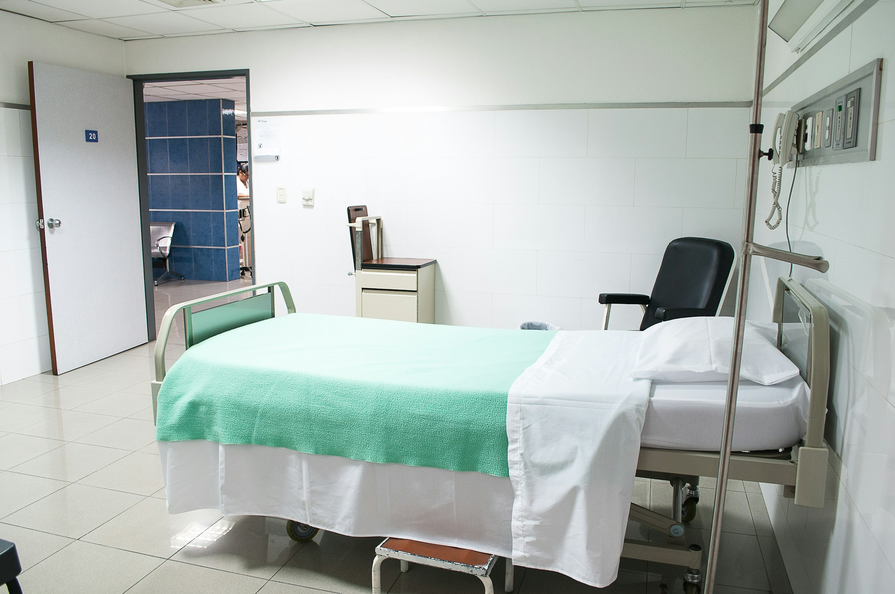

{fig-align="center"}

<link rel="stylesheet" href="https://cdnjs.cloudflare.com/ajax/libs/font-awesome/6.4.0/css/all.min.css">

[<i class="fas fa-bookmark"></i> Slides](../sword2026/causp_slide.html){.btn .btn-sm .btn-outline-primary}

**Date:** Oct 14 2026 18:15 PM\
**Event:** SWORDS network event\
**Location:** School of Mathematics, Cardiff University, UK

## Context

At the [`SWORDS (South Wales OR) Network Event`](https://www.theorsociety.com/ORS/Community/Regionals-List/South-Wales-OR-Network.aspx), we will present one of our PhD project on Causal Impact of Diagnosis on Length of Stay. This project aims to understand how different diagnoses influence the duration of hospital stays, leveraging Double Machine Learning techniques to estimate causal effects and develop discharge planning strategies accordingly.