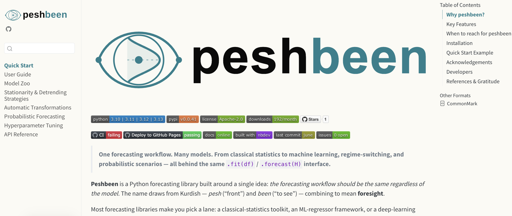



```{python}
#| echo: false
from IPython.display import HTML

_outline_items = [
    "Problem & Motivation",
    "Interdependent Multi-Series Forecasting Framework",
    "Experimental Setup & Three Forecasting Approaches",
    "Empirical Results: Point & Probabilistic Forecasting",
    "Operational Implications & Next Steps"
]

def outline(active=None, title="Outline", title_size="2em", section_size="1.5em", font_size=None, active_color="#20808D", inactive_color="#999999", line_height="1.8"):
    # If font_size is passed, use it for section_size
    if font_size is not None:
        section_size = font_size

    def _color(i, t):
        if active is None:
            return inactive_color
        if isinstance(active, int) and (active == i + 1 or (active == 0 and i == 0)):
            return active_color
        if isinstance(active, str) and active.lower() in t.lower():
            return active_color
        return inactive_color

    lis = "".join(
        f'<li style="color: {_color(i, t)};"><span style="color: {_color(i, t)};">{t}</span></li>\n'
        for i, t in enumerate(_outline_items)
    )
    return HTML(f"""
<br>
<br>
<p><span class="mimic-h2" style="font-size: {title_size};">{title}</span></p>
<div style="font-weight: bold; font-size: {section_size}; line-height: {line_height};">
<ul>
{lis}</ul>
</div>
""")
```

## 

```{python}
#| echo: false
outline(1)
```

## The Clinical & Operational Problem

<br>

::::{.columns style="display: flex; align-items: center;"}
:::{.column width="48%"}

:::{style="font-size: 1.12em; line-height: 1.6; padding-right: 20px;"}
- **Siloed Hospital Operations:** Fragmented decision-making across multidisciplinary wards contributes to systemic delays, prolonged stays, and delayed discharges.

- **Systemic "Ripple Effects":** Admission surges in one clinical specialty act as leading indicators of downstream discharge pressure and bed blocking in others.

- **Patient Off-Placement:** When target wards reach capacity, patients are boarded in non-specialist beds—inflating length of stay and compounding hospital gridlock.
:::

:::

:::{.column width="52%"}
{width="100%" style="border-radius: 12px; box-shadow: 0 10px 30px rgba(0,0,0,0.15);"}
:::
::::

## The Scale of the Challenge

### Capturing hospital-wide patient flow dynamics across 58 coupled time series

<br>

::::{.columns .equal-height}
:::{.column .border-box style="background-color: #E8F4F5;" .fragment}
[29]{style="font-size: 2.5em; font-weight: 800; color: #20808D; display: block;"}
[Clinical Specialties]{style="font-size: 1.4em; font-weight: 600; color: #091717; display: block; margin-top: 10px;"}
General Medicine, Surgery, Trauma, Cardiology, Haematology, ICU, etc.
:::

:::{.column .border-box style="background-color: #DEF7F9;" .fragment}
[2 Flow Types]{style="font-size: 2.5em; font-weight: 800; color: #0B363C; display: block;"}
[Admissions & Discharges]{style="font-size: 1.4em; font-weight: 600; color: #091717; display: block; margin-top: 10px;"}
Strongly coupled daily inflows and outflows across wards
:::

:::{.column .border-box style="background-color: #FDE8E8;" .fragment}
[58 Series]{style="font-size: 2.5em; font-weight: 800; color: #BF505C; display: block;"}
[Simultaneous Time Series]{style="font-size: 1.4em; font-weight: 600; color: #091717; display: block; margin-top: 10px;"}
5+ years of daily NHS inpatient data ($>109,000$ panel observations)
:::
::::

<br>

:::{style="text-align: center; font-size: 1.3em; font-weight: 600; color: #0B363C; margin-top: 15px;" .fragment}
**Research Question:**<br>
Can exploiting interdependencies across specialties in **ONE unified model** improve **forecasting accuracy** over 58 independent models?
:::

## Conventional Baseline: 58 Independent Single-Series Models

<br>

::::{.columns .equal-height}
:::{.column width="50%" .fragment}
:::{.callout-warning icon="false" .equal-height}
## Independent Univariate Modeling
- Fit **58 separate forecasting models** (one per specialty and flow type).
- Maintain, tune, and monitor each series in complete isolation:
  - Hyperparameter tuning repeated **58 independent times** ($58 \times 75 = 4,350$ CV evaluations per model family).
- Each model conditions exclusively on its **own historical lags**:
$$
\hat{y}_{t+1}^{(i)} = f_i\left(y_t^{(i)}, y_{t-1}^{(i)}, \dots, y_{t-p}^{(i)}, \mathbf{Z}_t\right)
$$
:::
:::

:::{.column width="50%" .fragment}
:::{.callout-important icon="false" .equal-height}

## Why Siloed Forecasting Falls Short

- **Ignores Cross-Specialty Spillovers:** Admissions and discharges are tightly coupled within and across specialties ($r > 0.80$ in core medical/surgical wards). Univariate models are blind to upstream admission surges.

- **Data Fragmentation:** Each model trains on only $\sim 1,880$ daily observations rather than pooling shared seasonal and calendar structure across all $109,000+$ hospital records.

- **Operational Maintenance Burden:** Scaling and auditing 58 separate pipelines for point and probabilistic forecasting creates substantial technical debt.
:::
:::
::::

<br>

:::{style="text-align: center; font-size: 1.5em; font-weight: bold; color: #20808D;" .fragment}
&#10140; Proposed Solution: Jointly model all 58 streams via an **Interdependent Multi-Series Forecasting Framework**
:::

## 

```{python}
#| echo: false
outline(2)
```

## Proposed Framework: Three Forecasting Architectures Compared

<br>

::::{.columns .deck-cards}

:::{.column width="33%" .card-teal .fragment}
[Approach 1:<br>Single-Series Baseline]{.card-header style="font-size: 1.02em;"}


- **Architecture:** **58 separate models** ($f_1, \dots, f_{58}$), tuned independently.
- **Lag Inputs:** Own lags $1 \dots 7$ only ($\mathbf{7}$ lag features per model).
- **Cross-Series Info:** **None** — ignores cross-specialty spillovers.
:::

:::{.column width="33%" .card-teal .fragment}
[Approach 2:<br>Multi-Series (All Lags)]{.card-header style="font-size: 1.02em;"}


- **Architecture:** **1 unified global model** $\mathcal{M}$ predicting all 58 series at once.
- **Lag Inputs:** Lags $1 \dots 7$ of **all 58 series** ($58 \times 7 = \mathbf{406}$ lag features).
- **Cross-Series Info:** Full hospital-wide inflow and outflow visibility.
:::

:::{.column width="33%" .card-teal .fragment}
[Approach 3:<br>Multi-Series (Selected Lags)]{.card-header style="font-size: 1.02em;"}

- **Architecture:** **1 unified global model** $\mathcal{M}$ with pruned cross-lags.
- **Lag Inputs:** **1 dominant series per specialty** ($28 \times 7 = \mathbf{196}$ lags; **$-51\%$** features).
- **Selection Rule:** Composite $R^2$ test ($p < 0.05, |r| \ge 0.20$) on Adm vs. Dis.
:::

::::

## Mathematical Formulation: Interdependent Multi-Series Model

:::: {.columns}

::: {.column width="62%"}
::: {style="border-right: 1px solid #D2DFDF; padding-right: 25px;"}

- **Global Functional Mapping:**  
  Instead of 58 disconnected functions, a single model $\mathcal{M}$ predicts patient flow $y_{i,t}$ for any target stream $i \in \{1, \dots, 58\}$:
  $$y_{i, t} = \mathcal{M}\left( s_i, \, \mathbf{X}_{t}^{\text{cross}}, \, \mathbf{Z}_{t} \right) + \epsilon_{i, t}, \qquad i = 1, \dots, N$$

- **Cross-Specialty Feature Representation ($\mathbf{X}_{t}^{\text{cross}}$):**  
  Concatenates $p=7$ autoregressive lags across the active set of series $\mathcal{S}$ ($\mathcal{S}_{\text{full}} = 58$ series in Approach 2; $\mathcal{S}_{\text{sel}} = 28$ dominant specialty series in Approach 3):
  $$\mathbf{X}_{t}^{\text{cross}} = \Big[\mathbf{y}_{t-1:t-p}^{(k)}\Big]_{k \in \mathcal{S}} \in \mathbb{R}^{|\mathcal{S}| \cdot p}$$

- **Pooled Empirical Risk Minimization:**  
  Learned jointly across all $N=58$ streams and training days via `peshbeen`:
  $$\min_{\mathcal{M}} \sum_{i=1}^{N} \sum_{t=p+1}^{T} \mathcal{L}\left( y_{i, t}, \, \mathcal{M}\left(s_i, \, \mathbf{X}_{t}^{\text{cross}}, \, \mathbf{Z}_{t}\right) \right) + \Omega(\mathcal{M})$$

:::
:::

::: {.column width="38%"}
::: {style="padding-left: 20px; font-size: 0.95em; line-height: 1.55;"}

[**Notation & Model Interface (`peshbeen`):**]{style="color: #0B363C; font-size: 1.08em; font-weight: bold; display: block; margin-bottom: 8px;"}

- $y_{i,t}$: Daily admissions or discharges for stream $i$ on day $t$
- $s_i$: Categorical series identifier
- $\mathcal{S}_{\text{full}}$ vs. $\mathcal{S}_{\text{sel}}$: 406 full lags vs. 196 selected lags
- $\mathbf{Z}_t$: Calendar dates (e.g., day of week, day of month), bank holidays, time trend, and capacity expansion time
- $\mathcal{M}(\cdot)$: Pluggable estimator in `peshbeen` (`ml_multi_forecaster`):
  - **LightGBM**, **XGBoost**, **CatBoost**, **Random Forest**, **Ridge**

:::
:::

::::

## The Multi-Series Training Matrix Architecture

<br>




## Recursive Multi-Step & Probabilistic Forecasting ($H = 42$ Days)


<br>

::::{.columns .deck-cards}
:::{.column width="33%" .card-teal .fragment}

[1. Step $h = 1$ (Observed History)]{.card-header}

- Model ingests observed cross-series lags up to origin $t$:
$$
\mathbf{X}_{t} = \left[\mathbf{y}_{t:t-6}^{(k)},\, \mathbf{Z}_{t+1}\right]_{k \in \mathcal{S}}
$$

- Generates 1-step ahead predictions $\hat{\mathbf{y}}_{t+1} = \mathcal{M}(\mathbf{X}_t)$ for **all 58 series simultaneously**.

:::

:::{.column width="33%" .card-teal .fragment}

[2. Steps $h = 2 \dots 42$]{.card-header}

- Predicted flows $\hat{\mathbf{y}}_{t+h-1}$ roll into the lag vector for step $h$:
$$\text{Lag}_1 \leftarrow \hat{\mathbf{y}}_{t+h-1}, \quad \text{Lag}_2 \leftarrow \hat{\mathbf{y}}_{t+h-2}$$
- Admission surges predicted on day $t+1$ dynamically feed into downstream specialty discharge forecasts over the 6-week horizon.
:::

:::{.column width="33%" .card-teal .fragment}
[3. Joint Probabilistic Scenarios]{.card-header}

- Via `multi_prob_forecasts` in `peshbeen`, empirical residual covariance is estimated across horizons.
- Generates **10,000 Monte Carlo sample paths** per fold, yielding full predictive distributions for every specialty and horizon $h \in \{1, \dots, 42\}$.
:::
::::

## 

```{python}
#| echo: false
outline(3)
```

## Experimental Design & Evaluation Protocol

<br>

::::{.columns .deck-cards}
:::{.column width="50%" .card-teal}
[NHS Inpatient Dataset & Cross-Validation Design]{.card-header}

- **Dataset:** Daily NHS inpatient admissions and discharges (Jan 2021 – Feb 2026; 29 specialties $\times$ 2 flows $= \mathbf{58}$ series).
- **Exogenous Covariates:** Day of week, month, bank holidays, linear time index, General Medicine capacity step-change, plus Fourier terms & interactions for linear models.
- **Rolling-Origin Evaluation:**
  - **30 rolling evaluation windows**, forecast horizon **$H = 42$ days** (6 weeks), step size $= 12$ days.
  - Hyperparameter tuning via **Optuna** on the training partition.
:::

:::{.column width="50%" .card-teal}
[Five Model Families & Two Evaluation Metrics]{.card-header}

- **Five Diverse Learning Algorithms Evaluated Across All 3 Approaches:**
  1. **LightGBM:** Leaf-wise histogram GBDT with native categorical handling & $L_1/L_2$ regularisation.
  2. **XGBoost:** Depth/leaf-regularised histogram gradient boosting.
  3. **CatBoost:** Oblivious trees (symmetric splits across all nodes at a given depth).
  4. **Random Forest:** Bagged decision tree ensemble (no sequential residual boosting).
  5. **Ridge Regression:** Linear $L_2$-penalised model with one-hot series & interaction encoding.
- **Metrics:** **RMSSE** (Point Forecasting) and **Pinball Loss** across predictive quantiles (Probabilistic Forecasting).
:::
::::

## Forecast Evaluation Metrics

### Scale-independent point accuracy (RMSSE) and distributional accuracy across quantiles (Pinball Loss)

::::{.columns .deck-cards}
:::{.column width="50%" .card-teal}
[Point Forecasting:<br>Root Mean Squared Scaled Error (RMSSE)]{.card-header}

$$\text{RMSSE} = \sqrt{\frac{\frac{1}{H}\sum_{h=1}^{H}\left(y_{t+h} - \hat{y}_{t+h}\right)^2}{\frac{1}{T-1}\sum_{t=2}^{T}\left(y_t - y_{t-1}\right)^2}}$$

- **Scale-Independent Comparison:** Normalises forecast errors by the in-sample one-step naïve random walk, allowing fair aggregation across high-volume (General Medicine) and low-volume specialties.
- **Relative Gain (%):** $\frac{\text{RMSSE}_{\text{Single}} - \text{RMSSE}_{\text{Multi}}}{\text{RMSSE}_{\text{Single}}} \times 100$.

:::

:::{.column width="50%" .card-teal}
[Probabilistic Forecasting:<br>Integrated Pinball Loss]{.card-header}

$$L_\tau(y, \hat{q}_\tau) = \max\left(\tau(y - \hat{q}_\tau), \, (\tau - 1)(y - \hat{q}_\tau)\right)$$
$$\overline{\text{PL}}(F, y) = 2 \int_0^1 L_\tau\left(y, F^{-1}(\tau)\right) d\tau$$

- **Full Distributional Evaluation:** Assesses calibration and sharpness across all predictive quantiles $\tau \in (0, 1)$ from 10,000 Monte Carlo trajectories across horizons $h = 1 \dots 42$.
- **Lower Pinball Loss = Superior Probabilistic Quality** (Skill gain $>0\%$ indicates reduction in Pinball Loss over Single-Series).

:::
::::

## 

```{python}
#| echo: false
outline(4)
```

## Point Forecasting Results

::::{.columns style="align-items: flex-start;"}
:::{.column width="53%"}

```{python}
#| fig-width: 100%
#| fig-height: 100%
#| fig-align: center

import matplotlib.pyplot as plt
import seaborn as sns
import pandas as pd
import numpy as np

df = pd.read_csv('tables/point_comparison.csv')

plt.rcParams['figure.facecolor'] = '#FBFAF4'
plt.rcParams['axes.facecolor'] = '#FBFAF4'
plt.rcParams['font.sans-serif'] = 'Helvetica'

fig, ax = plt.subplots(figsize=(12.5, 7))

models = ['lgb', 'xgb', 'cat', 'rf', 'ridge']
model_labels = ['LightGBM\n(Winner)', 'XGBoost', 'CatBoost', 'Random\nForest', 'Ridge\n(Linear)']

summary = df.groupby('model').agg(
    Sing=('RMSSE_sing', 'mean'),
    M7=('RMSSE_multi_7', 'mean'),
    MDict=('RMSSE_multi_dict', 'mean'),
    Imp_M7=('imp_m7_pct', 'mean'),
    Imp_MDict=('imp_mdict_pct', 'mean'),
    Wins_M7=('imp_m7_pct', lambda x: (x > 0).sum()),
    Wins_MDict=('imp_mdict_pct', lambda x: (x > 0).sum())
).loc[models]

# --- PANEL 1: Grouped Bar Chart of Mean RMSSE ---
x = np.arange(len(models))
width = 0.26

b1 = ax.bar(x - width, summary['Sing'], width, label='Approach 1: Single-Series (58 Separate Models)', color='#0B363C', alpha=0.92)
b2 = ax.bar(x, summary['M7'], width, label='Approach 2: Multi-Series (All 58 Series Lags, 406 feats)', color='#20808D', alpha=0.95)
b3 = ax.bar(x + width, summary['MDict'], width, label='Approach 3: Multi-Series (Selected Lags, 196 feats)', color='#E69F00', alpha=0.92)

ax.set_xticks(x)
ax.set_xticklabels(model_labels, fontsize=15, fontweight='bold')
ax.set_ylabel('Mean RMSSE Across 58 Series\n(Lower is Better)', fontsize=15, fontweight='bold')
ax.set_title('Mean Point Forecast Error (RMSSE) by Approach & Model', fontsize=18, fontweight='bold', pad=12)
ax.set_ylim(0, 0.98)
ax.grid(axis='y', alpha=0.3)
ax.tick_params(labelsize=13.5)
ax.legend(fontsize=13, loc='upper left', framealpha=0.95)

for rects, col in [(b1, '#0B363C'), (b2, '#16606A'), (b3, '#B2582D')]:
    for r in rects:
        h = r.get_height()
        ax.annotate(f'{h:.3f}', xy=(r.get_x() + r.get_width()/2, h),
                    xytext=(0, 4), textcoords='offset points', ha='center', va='bottom',
                    fontsize=12, fontweight='bold', color=col)

plt.tight_layout()
plt.show()
```

:::{.note-card .fragment}
- **LightGBM (Winner) beats every single-series model in the study **(+5.76%, 51/58 wins)**.
- **Pruning Features Helps XGBoost:** improves 14/29 discharge series.
- **Ridge Linearity Collapse:** degrades ($-47.5\%$) due to rigid cross-lag collinearity.
:::

:::
:::{.column width="47%" .fragment}

```{python}
#| fig-width: 100%
#| fig-height: 100%
#| fig-align: center

fig, ax2 = plt.subplots(figsize=(11.5, 7))

# --- PANEL 2: Relative Improvement Boxplot across 58 Series (Non-linear models) ---
plot_df = pd.melt(
    df[df['model'].isin(['lgb', 'xgb', 'cat', 'rf'])],
    id_vars=['series', 'model', 'flow_type'],
    value_vars=['imp_m7_pct', 'imp_mdict_pct'],
    var_name='Approach',
    value_name='Improvement_Pct'
)
plot_df['Approach'] = plot_df['Approach'].map({
    'imp_m7_pct': 'Approach 2: Multi-Series (All Lags)',
    'imp_mdict_pct': 'Approach 3: Multi-Series (Selected Lags)'
})

sns.boxplot(
    data=plot_df, x='model', y='Improvement_Pct', hue='Approach',
    order=['lgb', 'xgb', 'cat', 'rf'],
    palette={'Approach 2: Multi-Series (All Lags)': '#20808D', 'Approach 3: Multi-Series (Selected Lags)': '#E69F00'},
    ax=ax2, width=0.55, fliersize=4, boxprops=dict(alpha=0.88)
)

ax2.axhline(0, color='#BF505C', linestyle='--', linewidth=2, label='Single-Series Baseline (0%)')
ax2.set_xticks(range(4))
ax2.set_xticklabels(['LightGBM\n(+5.8% / +4.9%)', 'XGBoost\n(-1.4% / -0.6%)', 'CatBoost\n(-8.0% / -9.2%)', 'Random Forest\n(-10.1% / -11.4%)'], fontsize=14, fontweight='bold')
ax2.set_ylabel('RMSSE Reduction vs. Single-Series (%)\n(Positive = Multi-Series Outperforms)', fontsize=14.5, fontweight='bold')
ax2.set_xlabel('')
ax2.set_title('Series-Level Accuracy Gains Across Tree Architectures (N = 58)', fontsize=17, fontweight='bold', pad=12)
ax2.legend(fontsize=12.5, loc='lower left', framealpha=0.95)
ax2.grid(axis='y', alpha=0.3)
ax2.tick_params(labelsize=13)

plt.tight_layout()
plt.show()
```

:::{.note-card .fragment}
- **LightGBM** achieves consistent gains across **51/58** series.
:::

:::
::::

---

## Specialty-Level Point Forecast Gains: Admissions vs. Discharges

::::{.columns style="align-items: flex-start;"}
:::{.column width="53%"}

```{python}
#| fig-width: 100%
#| fig-height: 100%
#| fig-align: center

lgb_df = df[df['model'] == 'lgb'].copy()

fig, ax1 = plt.subplots(figsize=(12.5, 8))

# --- PANEL 1: Top 18 Specialties Comparing Approach 2 (All Lags) & Approach 3 (Selected Lags) ---
top18 = lgb_df.sort_values('imp_m7_pct', ascending=True).tail(18)
y_pos = np.arange(len(top18))
h_bar = 0.38

bars_m7 = ax1.barh(y_pos + h_bar/2, top18['imp_m7_pct'], height=h_bar, color='#20808D', alpha=0.95,
                   label='Approach 2: Multi-Series All Lags (406 lag features)')
bars_md = ax1.barh(y_pos - h_bar/2, top18['imp_mdict_pct'], height=h_bar, color='#E69F00', alpha=0.90,
                   label='Approach 3: Multi-Series Selected Lags (196 lag features)')

ax1.set_yticks(y_pos)
ax1.set_yticklabels([f"{r['specialty_clean']} ({r['flow_type'][:3]})" for _, r in top18.iterrows()],
                    fontsize=13.5, fontweight='bold')
ax1.set_xlabel('RMSSE Reduction over Single-Series Baseline (%)', fontsize=14.5, fontweight='bold')
ax1.set_title('Top 18 Clinical Streams Improved by Multi-Series LightGBM', fontsize=17, fontweight='bold', pad=12)
ax1.axvline(0, color='black', linewidth=1.2)
ax1.set_xlim(0, 29)
ax1.grid(axis='x', alpha=0.3)
ax1.tick_params(axis='x', labelsize=13)
ax1.legend(fontsize=12, loc='lower right', framealpha=0.95)

for bar in bars_m7:
    w = bar.get_width()
    ax1.annotate(f'+{w:.1f}%', xy=(w, bar.get_y() + bar.get_height()/2),
                 xytext=(5, 0), textcoords='offset points', ha='left', va='center',
                 fontsize=11.5, fontweight='bold', color='#0B363C')

plt.tight_layout()
plt.show()
```

:::{.note-card style="font-size: 0.6em;" .fragment}
- **Top Specialty Gains:** Peaks in **Haematology (+25.2%)**, **Ophthalmology (+20.1%)**, and **Neurology (+15.2%)**.
- **Widespread Lift:** **51 of 58** series improve under full multi-series LightGBM; **45 of 58** retain gains under pruned lags.
:::

:::
:::{.column width="47%" .fragment}

```{python}
#| fig-width: 100%
#| fig-height: 100%
#| fig-align: center

fig, ax2 = plt.subplots(figsize=(11.5, 8))

# --- PANEL 2: Admissions vs Discharges Breakdown & Efficiency Retention ---
flow_summary = lgb_df.groupby('flow_type').agg(
    M7_Mean=('imp_m7_pct', 'mean'),
    MD_Mean=('imp_mdict_pct', 'mean'),
    M7_Wins=('imp_m7_pct', lambda x: (x > 0).sum()),
    MD_Wins=('imp_mdict_pct', lambda x: (x > 0).sum())
).loc[['Discharge', 'Admission']]

fx = np.arange(2)
fw = 0.32
fb1 = ax2.bar(fx - fw/2, flow_summary['M7_Mean'], fw, color='#20808D', label='Approach 2: All Lags (51/58 Wins)')
fb2 = ax2.bar(fx + fw/2, flow_summary['MD_Mean'], fw, color='#E69F00', label='Approach 3: Selected Lags (45/58 Wins)')

ax2.set_xticks(fx)
ax2.set_xticklabels(['Hospital Discharges\n(29 Specialties)', 'Hospital Admissions\n(29 Specialties)'], fontsize=14.5, fontweight='bold')
ax2.set_ylabel('Mean RMSSE Improvement vs. Single-Series (%)', fontsize=14.5, fontweight='bold')
ax2.set_title('Discharges Benefit Most from Cross-Series Lags', fontsize=17, fontweight='bold', pad=12)
ax2.set_ylim(0, 8.2)
ax2.grid(axis='y', alpha=0.3)
ax2.tick_params(labelsize=13)
ax2.legend(fontsize=12.5, loc='upper right', framealpha=0.95)

annotations = [
    (fb1[0], f"+{flow_summary.loc['Discharge', 'M7_Mean']:.2f}%\n(26/29 Wins)", '#0B363C'),
    (fb2[0], f"+{flow_summary.loc['Discharge', 'MD_Mean']:.2f}%\n(24/29 Wins)", '#8A3D14'),
    (fb1[1], f"+{flow_summary.loc['Admission', 'M7_Mean']:.2f}%\n(25/29 Wins)", '#0B363C'),
    (fb2[1], f"+{flow_summary.loc['Admission', 'MD_Mean']:.2f}%\n(21/29 Wins)", '#8A3D14'),
]
for rect, txt, col in annotations:
    h = rect.get_height()
    ax2.annotate(txt, xy=(rect.get_x() + rect.get_width()/2, h),
                 xytext=(0, 6), textcoords='offset points', ha='center', va='bottom',
                 fontsize=13, fontweight='bold', color=col)

plt.tight_layout()
plt.show()
```

:::{.note-card style="font-size: 0.6em;" .fragment}
- **Discharges Benefit Most:** Gain **+6.46%** (vs +5.06% for Admissions), confirming upstream admissions act as leading indicators of discharge patterns.
- **Parsimonious Efficiency:** Approach 3 cuts lag dimensionality by **$>51\%$** ($406 \rightarrow 196$) while retaining **86%** of the full-model accuracy gain (+4.93% vs +5.76%).
:::

:::
::::

---

## Probabilistic Forecasting Results: Pinball Loss Across Models & Horizons

::::{.columns style="align-items: flex-start;"}
:::{.column width="52%"}

```{python}
#| fig-width: 100%
#| fig-height: 100%
#| fig-align: center

ps_ser = pd.read_csv('tables/pscore_series_summary.csv')

fig, ax1 = plt.subplots(figsize=(12, 7))

# --- PANEL 1: Overall Pinball Loss by Model & Approach (All Horizons 1-42) ---
sub_all = ps_ser[ps_ser['horizon_range'] == 'All (1-42)']
models_order = ['lgb', 'xgb', 'cat', 'rf', 'ridge']
m_names = ['LightGBM\n(Winner)', 'XGBoost\n(Runner-Up)', 'CatBoost', 'Random\nForest', 'Ridge\n(Linear)']

ps_mod = sub_all.groupby('model').agg(
    Sing=('ps_sing', 'mean'),
    M7=('ps_multi_7', 'mean'),
    MDict=('ps_multi_dict', 'mean'),
    Imp_M7=('imp_m7_pct', 'mean'),
    Imp_MDict=('imp_mdict_pct', 'mean'),
    Wins_M7=('imp_m7_pct', lambda x: (x > 0).sum()),
    Wins_MDict=('imp_mdict_pct', lambda x: (x > 0).sum())
).loc[models_order]

x = np.arange(len(models_order))
w = 0.26
p1 = ax1.bar(x - w, ps_mod['Sing'], w, label='Approach 1: Single-Series (58 Separate Models)', color='#0B363C', alpha=0.92)
p2 = ax1.bar(x, ps_mod['M7'], w, label='Approach 2: Multi-Series All Lags (406 feats)', color='#20808D', alpha=0.95)
p3 = ax1.bar(x + w, ps_mod['MDict'], w, label='Approach 3: Multi-Series Selected Lags (196 feats)', color='#E69F00', alpha=0.92)

ax1.set_xticks(x)
ax1.set_xticklabels(m_names, fontsize=14.5, fontweight='bold')
ax1.set_ylabel('Mean Pinball Loss Across Horizons\n(Lower is Better)', fontsize=14.5, fontweight='bold')
ax1.set_title('Probabilistic Pinball Loss Across Models & Approaches (H = 1–42)', fontsize=17, fontweight='bold', pad=12)
ax1.set_ylim(0, 4.1)
ax1.grid(axis='y', alpha=0.3)
ax1.tick_params(labelsize=13)
ax1.legend(fontsize=12.5, loc='upper left', framealpha=0.95)

for rects, col in [(p1, '#0B363C'), (p2, '#16606A'), (p3, '#B2582D')]:
    for r in rects:
        h = r.get_height()
        ax1.annotate(f'{h:.2f}', xy=(r.get_x() + r.get_width()/2, h),
                     xytext=(0, 4), textcoords='offset points', ha='center', va='bottom',
                     fontsize=12, fontweight='bold', color=col)

plt.tight_layout()
plt.show()
```

:::{.note-card style="font-size: 0.6em;" .fragment}
- **LightGBM Multi-Series:** Substantial gain over Single-Series (**2.52 $\rightarrow$ 2.36**, $+4.5–4.9\%$, up to **51/58** wins).
- **Lowest Absolute Pinball Loss:** XGBoost Selected Lags (**2.34**) achieves lowest overall distributional error, improving over Single-Series (2.352).
:::

:::
:::{.column width="48%" .fragment}

```{python}
#| fig-width: 100%
#| fig-height: 100%
#| fig-align: center

fig, ax2 = plt.subplots(figsize=(11.5, 7))

# --- PANEL 2: Pinball Loss Improvement Across Horizon Windows (LightGBM vs XGBoost) ---
h_order = ['1-7', '8-14', '15-21', '22-42']
h_labels = ['Days 1–7\n(Week 1)', 'Days 8–14\n(Week 2)', 'Days 15–21\n(Week 3)', 'Days 22–42\n(Weeks 4–6)']

lgb_h = ps_ser[(ps_ser['model'] == 'lgb') & (ps_ser['horizon_range'].isin(h_order))]
xgb_h = ps_ser[(ps_ser['model'] == 'xgb') & (ps_ser['horizon_range'].isin(h_order))]

hx = np.arange(len(h_order))
hw = 0.20

lgb_m7_means = [lgb_h[lgb_h['horizon_range'] == h]['imp_m7_pct'].mean() for h in h_order]
lgb_md_means = [lgb_h[lgb_h['horizon_range'] == h]['imp_mdict_pct'].mean() for h in h_order]
xgb_md_means = [xgb_h[xgb_h['horizon_range'] == h]['imp_mdict_pct'].mean() for h in h_order]

hb1 = ax2.bar(hx - hw, lgb_m7_means, hw, label='LightGBM: Approach 2 (All Lags)', color='#20808D', alpha=0.95)
hb2 = ax2.bar(hx, lgb_md_means, hw, label='LightGBM: Approach 3 (Selected Lags)', color='#2CA0AB', alpha=0.90)
hb3 = ax2.bar(hx + hw, xgb_md_means, hw, label='XGBoost: Approach 3 (Selected Lags)', color='#E69F00', alpha=0.90)

for rects, col in [(hb1, '#0B363C'), (hb2, '#16606A'), (hb3, '#8A3D14')]:
    for r in rects:
        h = r.get_height()
        va = 'bottom' if h >= 0 else 'top'
        ax2.annotate(f'{h:+.1f}%', xy=(r.get_x() + r.get_width()/2, h),
                     xytext=(0, 4 if h >= 0 else -14), textcoords='offset points',
                     ha='center', va=va, fontsize=11.5, fontweight='bold', color=col)

ax2.axhline(0, color='black', linestyle='--', linewidth=1.5, alpha=0.7)
ax2.set_xticks(hx)
ax2.set_xticklabels(h_labels, fontsize=14.5, fontweight='bold')
ax2.set_ylabel('Pinball Loss Reduction vs. Single-Series (%)\n(Positive = Multi-Series Improves)', fontsize=14, fontweight='bold')
ax2.set_title('Skill Gains Strengthen Over Longer Horizons', fontsize=17, fontweight='bold', pad=12)
ax2.set_ylim(-5.0, 8.8)
ax2.grid(axis='y', alpha=0.3)
ax2.tick_params(labelsize=13)
ax2.legend(fontsize=12, loc='upper left', framealpha=0.95)

plt.tight_layout()
plt.show()
```

:::{.note-card style="font-size: 0.6em;" .fragment}
- **Long-Horizon Peak (Weeks 3–6):** Gains peak in Days 15–21 (**+5.95%** M-All, **+5.79%** M-Sel); **89.7%** of series (52/58) improved in Days 22–42.
- **XGBoost Crossover:** While negative in Week 1, XGBoost turns net-positive at Days 22–42 (+0.18%) under Selected Lags.
:::

:::
::::

---

## System-Wide Probabilistic Improvements Across All 58 Clinical Series

::::{.columns style="align-items: center;"}
:::{.column width="50%"}

```{python}
#| fig-width: 100%
#| fig-height: 100%
#| fig-align: center

fig, ax = plt.subplots(figsize=(11.5, 9.2))
lgb_clean = ps_ser[(ps_ser['model'] == 'lgb') & (ps_ser['horizon_range'].isin(['1-7', '8-14', '15-21', '22-42']))].copy()

ft = 'Discharge'
sub = lgb_clean[lgb_clean['flow_type'] == ft].pivot(
    index='specialty_clean', columns='horizon_range', values='imp_m7_pct'
)[['1-7', '8-14', '15-21', '22-42']]

# Also attach Approach 3 (Selected Lags) overall mean for comparison in a 5th & 6th column
sub_all_ft = ps_ser[(ps_ser['model'] == 'lgb') & (ps_ser['flow_type'] == ft) & (ps_ser['horizon_range'] == 'All (1-42)')].set_index('specialty_clean')
sub['M-All (1–42)'] = sub_all_ft['imp_m7_pct']
sub['M-Sel (1–42)'] = sub_all_ft['imp_mdict_pct']
sub = sub.sort_values('M-All (1–42)', ascending=False)

cmap = sns.diverging_palette(10, 185, s=85, l=45, as_cmap=True)
sns.heatmap(sub, ax=ax, cmap=cmap, center=0, annot=True, fmt='.1f',
            cbar_kws={'label': 'Pinball Loss Reduction (%)'}, linewidths=0.4,
            annot_kws={'size': 9.5, 'weight': 'bold'}, vmin=-10, vmax=25)

win_m7 = (sub['M-All (1–42)'] > 0).sum()
win_md = (sub['M-Sel (1–42)'] > 0).sum()
ax.set_title(
    f'{ft} Streams: Pinball Loss Reduction (%) vs. Single-Series (LightGBM)\n'
    f'All Lags: {win_m7}/29 Improved (Mean +{sub["M-All (1–42)"].mean():.2f}%) | '
    f'Selected Lags: {win_md}/29 Improved (Mean +{sub["M-Sel (1–42)"].mean():.2f}%)',
    fontsize=16.5, fontweight='bold', pad=12
)
ax.set_xlabel('Forecasting Horizon Window & Multi-Series Approach', fontsize=13.5, fontweight='bold')
ax.set_ylabel('Clinical Specialty', fontsize=13.5, fontweight='bold')
ax.set_xticklabels(['Days 1–7', 'Days 8–14', 'Days 15–21', 'Days 22–42', 'All Lags\n(1–42)', 'Selected\n(1–42)'], fontsize=11.5, fontweight='bold')
ax.tick_params(axis='y', labelsize=10)

plt.tight_layout()
plt.show()
```

:::
:::{.column width="50%" .fragment}

```{python}
#| fig-width: 100%
#| fig-height: 100%
#| fig-align: center

fig, ax = plt.subplots(figsize=(11.5, 9.2))

ft = 'Admission'
sub = lgb_clean[lgb_clean['flow_type'] == ft].pivot(
    index='specialty_clean', columns='horizon_range', values='imp_m7_pct'
)[['1-7', '8-14', '15-21', '22-42']]

# Also attach Approach 3 (Selected Lags) overall mean for comparison in a 5th & 6th column
sub_all_ft = ps_ser[(ps_ser['model'] == 'lgb') & (ps_ser['flow_type'] == ft) & (ps_ser['horizon_range'] == 'All (1-42)')].set_index('specialty_clean')
sub['M-All (1–42)'] = sub_all_ft['imp_m7_pct']
sub['M-Sel (1–42)'] = sub_all_ft['imp_mdict_pct']
sub = sub.sort_values('M-All (1–42)', ascending=False)

cmap = sns.diverging_palette(10, 185, s=85, l=45, as_cmap=True)
sns.heatmap(sub, ax=ax, cmap=cmap, center=0, annot=True, fmt='.1f',
            cbar_kws={'label': 'Pinball Loss Reduction (%)'}, linewidths=0.4,
            annot_kws={'size': 9.5, 'weight': 'bold'}, vmin=-10, vmax=25)

win_m7 = (sub['M-All (1–42)'] > 0).sum()
win_md = (sub['M-Sel (1–42)'] > 0).sum()
ax.set_title(
    f'{ft} Streams: Pinball Loss Reduction (%) vs. Single-Series (LightGBM)\n'
    f'All Lags: {win_m7}/29 Improved (Mean +{sub["M-All (1–42)"].mean():.2f}%) | '
    f'Selected Lags: {win_md}/29 Improved (Mean +{sub["M-Sel (1–42)"].mean():.2f}%)',
    fontsize=16.5, fontweight='bold', pad=12
)
ax.set_xlabel('Forecasting Horizon Window & Multi-Series Approach', fontsize=13.5, fontweight='bold')
ax.set_ylabel('', fontsize=13.5, fontweight='bold')
ax.set_xticklabels(['Days 1–7', 'Days 8–14', 'Days 15–21', 'Days 22–42', 'All Lags\n(1–42)', 'Selected\n(1–42)'], fontsize=11.5, fontweight='bold')
ax.tick_params(axis='y', labelsize=10)

plt.tight_layout()
plt.show()
```

:::
::::

## Specialty-wise Accuracy Results

```{python}
#| echo: false
#| fig-align: center

import json
import warnings
warnings.filterwarnings('ignore')
import pandas as pd
import numpy as np
import plotly.graph_objects as go
from plotly.subplots import make_subplots
from IPython.display import display, HTML

# 1. Load data
my_data = pd.read_csv('tables/my_data.csv')
pt_df = pd.read_csv('tables/point_comparison.csv')
ps_df = pd.read_csv('tables/pscore_series_summary.csv')

# 2. Specialty dominance ranking from my_data.csv
adm_data = my_data[my_data['specialty'].str.startswith('adm_')].copy()
adm_means = adm_data.groupby('specialty')['flow'].mean()
total_mean = adm_means.sum()
dominance_pct = (adm_means / total_mean) * 100

mapping = pt_df[pt_df['flow_type'] == 'Admission'][['series', 'specialty_clean']].drop_duplicates().set_index('series')['specialty_clean'].to_dict()

spec_ranks = []
for adm_series, dom in dominance_pct.items():
    clean_name = mapping.get(adm_series, adm_series.replace('adm_', '').replace('_', ' ').title())
    spec_ranks.append({
        'clean_name': clean_name,
        'dominance': dom,
        'label': f'{clean_name} ({dom:.1f}%)'
    })
spec_ranks.sort(key=lambda x: x['dominance'], reverse=True)

models = ['lgb', 'xgb', 'cat', 'rf', 'ridge']
model_labels = [('lgb', 'LightGBM'), ('xgb', 'XGBoost'), ('cat', 'CatBoost'), ('rf', 'Random Forest'), ('ridge', 'Ridge')]

# 3. Build data store for instant JS switching
data_store = {}
for m in models:
    data_store[m] = {}
    m_pt = pt_df[pt_df['model'] == m]
    m_ps = ps_df[(ps_df['model'] == m) & (ps_df['horizon_range'] == 'All (1-42)')]
    
    pt_dis = m_pt[m_pt['flow_type'] == 'Discharge']
    pt_adm = m_pt[m_pt['flow_type'] == 'Admission']
    ps_dis = m_ps[m_ps['flow_type'] == 'Discharge']
    ps_adm = m_ps[m_ps['flow_type'] == 'Admission']
    
    data_store[m]['ALL'] = {
        'pt_m7': [round(float(pt_dis['imp_m7_pct'].mean()), 2), round(float(pt_adm['imp_m7_pct'].mean()), 2)],
        'pt_md': [round(float(pt_dis['imp_mdict_pct'].mean()), 2), round(float(pt_adm['imp_mdict_pct'].mean()), 2)],
        'ps_m7': [round(float(ps_dis['imp_m7_pct'].mean()), 2), round(float(ps_adm['imp_m7_pct'].mean()), 2)],
        'ps_md': [round(float(ps_dis['imp_mdict_pct'].mean()), 2), round(float(ps_adm['imp_mdict_pct'].mean()), 2)],
    }
    
    for s in spec_ranks:
        s_name = s['clean_name']
        s_pt_dis = m_pt[(m_pt['specialty_clean'] == s_name) & (m_pt['flow_type'] == 'Discharge')]
        s_pt_adm = m_pt[(m_pt['specialty_clean'] == s_name) & (m_pt['flow_type'] == 'Admission')]
        s_ps_dis = m_ps[(m_ps['specialty_clean'] == s_name) & (m_ps['flow_type'] == 'Discharge')]
        s_ps_adm = m_ps[(m_ps['specialty_clean'] == s_name) & (m_ps['flow_type'] == 'Admission')]
        
        pt_m7_dis = s_pt_dis['imp_m7_pct'].iloc[0] if len(s_pt_dis) > 0 else 0
        pt_m7_adm = s_pt_adm['imp_m7_pct'].iloc[0] if len(s_pt_adm) > 0 else 0
        pt_md_dis = s_pt_dis['imp_mdict_pct'].iloc[0] if len(s_pt_dis) > 0 else 0
        pt_md_adm = s_pt_adm['imp_mdict_pct'].iloc[0] if len(s_pt_adm) > 0 else 0
        
        ps_m7_dis = s_ps_dis['imp_m7_pct'].iloc[0] if len(s_ps_dis) > 0 else 0
        ps_m7_adm = s_ps_adm['imp_m7_pct'].iloc[0] if len(s_ps_adm) > 0 else 0
        ps_md_dis = s_ps_dis['imp_mdict_pct'].iloc[0] if len(s_ps_dis) > 0 else 0
        ps_md_adm = s_ps_adm['imp_mdict_pct'].iloc[0] if len(s_ps_adm) > 0 else 0
        
        data_store[m][s_name] = {
            'pt_m7': [round(float(pt_m7_dis), 2), round(float(pt_m7_adm), 2)],
            'pt_md': [round(float(pt_md_dis), 2), round(float(pt_md_adm), 2)],
            'ps_m7': [round(float(ps_m7_dis), 2), round(float(ps_m7_adm), 2)],
            'ps_md': [round(float(ps_md_dis), 2), round(float(ps_md_adm), 2)],
        }

init = data_store['lgb']['ALL']
def fmt(vals):
    return [f'+{v:.1f}%' if v > 0 else f'{v:.1f}%' for v in vals]

# 4. Build Plotly Base Figure
fig = make_subplots(
    rows=1, cols=2,
    subplot_titles=['<b>Point Forecast Improvement vs. Single-Series (%)</b>', '<b>Probabilistic Skill Gain vs. Single-Series (Mean H = 1–42, %)</b>'],
    horizontal_spacing=0.08
)

for a in fig['layout']['annotations']:
    a['font'] = dict(size=23, color='#0B363C', family='Helvetica', weight='bold')

# Left: Point Forecast Bars
fig.add_trace(go.Bar(
    x=['Discharges', 'Admissions'],
    y=init['pt_m7'],
    name='Approach 2: Multi-Series (All Lags)',
    marker_color='#20808D',
    text=fmt(init['pt_m7']),
    textposition='outside',
    textfont=dict(size=20, color='#0B363C', family='Helvetica', weight='bold')
), row=1, col=1)

fig.add_trace(go.Bar(
    x=['Discharges', 'Admissions'],
    y=init['pt_md'],
    name='Approach 3: Multi-Series (Selected Lags)',
    marker_color='#E69F00',
    text=fmt(init['pt_md']),
    textposition='outside',
    textfont=dict(size=20, color='#8A3D14', family='Helvetica', weight='bold')
), row=1, col=1)

# Right: Probabilistic Bars
fig.add_trace(go.Bar(
    x=['Discharges', 'Admissions'],
    y=init['ps_m7'],
    name='Approach 2: Multi-Series (All Lags)',
    marker_color='#20808D',
    text=fmt(init['ps_m7']),
    textposition='outside',
    showlegend=False,
    textfont=dict(size=20, color='#0B363C', family='Helvetica', weight='bold')
), row=1, col=2)

fig.add_trace(go.Bar(
    x=['Discharges', 'Admissions'],
    y=init['ps_md'],
    name='Approach 3: Multi-Series (Selected Lags)',
    marker_color='#E69F00',
    text=fmt(init['ps_md']),
    textposition='outside',
    showlegend=False,
    textfont=dict(size=20, color='#8A3D14', family='Helvetica', weight='bold')
), row=1, col=2)

fig.add_hline(y=0, line_dash='dash', line_color='#718B8E', line_width=1.8, row=1, col=1)
fig.add_hline(y=0, line_dash='dash', line_color='#718B8E', line_width=1.8, row=1, col=2)

fig.update_layout(
    barmode='group',
    bargap=0.28,
    bargroupgap=0.10,
    plot_bgcolor='#FBFAF4',
    paper_bgcolor='#FBFAF4',
    font=dict(family='Helvetica', size=16, color='#091717'),
    legend=dict(
        orientation='h',
        yanchor='bottom',
        y=-0.13,
        xanchor='center',
        x=0.5,
        font=dict(size=18, weight='bold')
    ),
    margin=dict(l=75, r=45, t=65, b=65),
    width=1740,
    height=780
)

fig.update_xaxes(
    tickfont=dict(size=23, weight='bold', color='#0B363C'),
    tickangle=0
)
fig.update_yaxes(
    tickfont=dict(size=16, weight='bold'),
    gridcolor='#E5EDED',
    zeroline=False,
    title=dict(text='Relative Accuracy Gain (%)', font=dict(size=19, weight='bold', color='#0B363C'))
)

plotly_html = fig.to_html(include_plotlyjs='cdn', full_html=False, div_id='plotly-explorer-graph')
json_data = json.dumps(data_store)

# 5. Build Top Controls and Embedded Interactive Wrapper
model_buttons_html = ''.join([
    f'<button class="pe-model-btn{" active" if m_id=="lgb" else ""}" data-model="{m_id}" onclick="setExplorerModel(\'{m_id}\', this)">{m_name}</button>'
    for m_id, m_name in model_labels
])

options_html = '<option value="ALL">★ Hospital-Wide Aggregate (All 58 Series)</option>' + ''.join([
    f'<option value="{s["clean_name"]}">{i}. {s["label"]}</option>'
    for i, s in enumerate(spec_ranks, 1)
])

ui_html = f'''
<div class="plotly-explorer-container" data-prevent-swipe>
  <style>
    .plotly-explorer-container {{
      width: 100%;
      max-width: 1840px;
      margin: 0 auto;
      font-family: 'Helvetica', 'Arial', sans-serif;
    }}
    .pe-top-bar {{
      display: flex;
      flex-direction: column;
      align-items: center;
      gap: 6px;
      background: #FFFFFF;
      border: 1.5px solid #D2E4E6;
      border-radius: 8px;
      padding: 6px 16px;
      margin-bottom: 2px;
      box-shadow: 0 2px 8px rgba(11, 54, 60, 0.04);
    }}
    .pe-group {{
      display: flex;
      align-items: center;
      gap: 8px;
    }}
    .pe-label {{
      font-size: 0.74em;
      font-weight: 700;
      color: #0B363C;
      text-transform: uppercase;
      letter-spacing: 0.4px;
      white-space: nowrap;
    }}
    .pe-model-btn {{
      background: #FFFFFF;
      border: 1.5px solid #CADBDD;
      color: #334D50;
      padding: 4px 11px;
      border-radius: 16px;
      font-size: 0.76em;
      font-weight: 600;
      cursor: pointer;
      transition: all 0.15s ease-in-out;
      white-space: nowrap;
    }}
    .pe-model-btn:hover {{
      border-color: #20808D;
      color: #20808D;
      background: #F2FBFB;
    }}
    .pe-model-btn.active {{
      background: #0B363C;
      border-color: #0B363C;
      color: #FFFFFF;
      box-shadow: 0 1px 6px rgba(11, 54, 60, 0.2);
    }}
    .pe-dropdown {{
      background: #FFFFFF;
      border: 1.8px solid #20808D;
      color: #0B363C;
      font-size: 0.78em;
      font-weight: 700;
      padding: 4px 10px;
      border-radius: 6px;
      cursor: pointer;
      min-width: 320px;
      outline: none;
    }}
    .pe-dropdown:focus {{
      border-color: #0B363C;
      box-shadow: 0 0 0 2px rgba(32, 128, 141, 0.2);
    }}
  </style>

  <div class="pe-top-bar">
    <div class="pe-group">
      <span class="pe-label">Model:</span>
      {model_buttons_html}
    </div>
    <div class="pe-group">
      <span class="pe-label">Specialty (Ranked by Inflow %):</span>
      <select id="pe-specialty-select" class="pe-dropdown" onchange="setExplorerSpecialty(this.value)">
        {options_html}
      </select>
    </div>
  </div>

  {plotly_html}

  <script>
    window.PE_DATA = {json_data};
    window.peCurrentModel = 'lgb';
    window.peCurrentSpecialty = 'ALL';

    function setExplorerModel(modelId, btnEl) {{
      window.peCurrentModel = modelId;
      document.querySelectorAll('.pe-model-btn').forEach(b => b.classList.remove('active'));
      if (btnEl) btnEl.classList.add('active');
      updatePlotlyExplorer();
    }}

    function setExplorerSpecialty(specName) {{
      window.peCurrentSpecialty = specName;
      updatePlotlyExplorer();
    }}

    function updatePlotlyExplorer() {{
      const dataStore = window.PE_DATA;
      if (!dataStore) return;
      const m = window.peCurrentModel;
      const s = window.peCurrentSpecialty;
      const item = dataStore[m] ? dataStore[m][s] : null;
      if (!item) return;

      function fmtText(arr) {{
        return arr.map(v => (v > 0 ? '+' : '') + v.toFixed(1) + '%');
      }}

      const graphDiv = document.getElementById('plotly-explorer-graph');
      if (!graphDiv || !graphDiv.data) return;

      const y_pt_m7 = item.pt_m7;
      const y_pt_md = item.pt_md;
      const y_ps_m7 = item.ps_m7;
      const y_ps_md = item.ps_md;

      // Calculate dynamic Y range with headroom so labels never clip
      const allVals = [...y_pt_m7, ...y_pt_md, ...y_ps_m7, ...y_ps_md];
      let minVal = Math.min(...allVals, 0);
      let maxVal = Math.max(...allVals, 0);

      let yMin = minVal < 0 ? minVal * 1.35 : -1;
      let yMax = maxVal > 0 ? maxVal * 1.35 : 1;
      if (yMax - yMin < 8) {{ yMax = 8; }}

      Plotly.animate(graphDiv, {{
        data: [
          {{ y: y_pt_m7, text: fmtText(y_pt_m7) }},
          {{ y: y_pt_md, text: fmtText(y_pt_md) }},
          {{ y: y_ps_m7, text: fmtText(y_ps_m7) }},
          {{ y: y_ps_md, text: fmtText(y_ps_md) }}
        ],
        layout: {{
          'yaxis.range': [yMin, yMax],
          'yaxis2.range': [yMin, yMax]
        }}
      }}, {{
        transition: {{ duration: 350, easing: 'cubic-in-out' }},
        frame: {{ duration: 350 }}
      }});
    }}

    function resizeExplorerPlot() {{
      const graphDiv = document.getElementById('plotly-explorer-graph');
      if (graphDiv && window.Plotly) {{
        Plotly.Plots.resize(graphDiv);
        Plotly.relayout(graphDiv, {{ autosize: true }});
      }}
    }}

    if (window.Reveal) {{
      Reveal.on('slidechanged', function(event) {{
        if (event.currentSlide && event.currentSlide.querySelector('#plotly-explorer-graph')) {{
          setTimeout(resizeExplorerPlot, 60);
        }}
      }});
    }}

    const plotEl = document.getElementById('plotly-explorer-graph');
    if (plotEl && window.IntersectionObserver) {{
      const obs = new IntersectionObserver(function(entries) {{
        entries.forEach(function(e) {{
          if (e.isIntersecting) {{
            setTimeout(resizeExplorerPlot, 60);
          }}
        }});
      }});
      obs.observe(plotEl);
    }}
  </script>
</div>
'''

display(HTML(ui_html))
```

## 

```{python}
#| echo: false
outline(5)
```

## Practical Implications, Limitations & Next Steps

<br>

::::{.columns .deck-cards}

:::{.column width="50%" .card-teal}
[Implications for Healthcare Operations]{.card-header}

- **Proactive Discharge Planning:** Cross-specialty admission signals improve discharge forecasts in **26/29** (point) and **28/29** (probabilistic) specialties.

- **Streamlined MLOps:** Replaces 58 isolated models with **1 unified `peshbeen` pipeline**.
:::

:::{.column width="50%" .card-teal}
[Methodological Caveats & Next Steps]{.card-header}

- **Estimator Sensitivity:** Multi-series gains might require learners with different characteristics, such as conditional tree splits and $L_1$ regularisation (LightGBM), while linear (Ridge) and symmetric (CatBoost) models may underperform under high lag dimensionality.

- **From Forecasts to Bed Allocation Decisions:**
  - Integrate joint probabilistic trajectories into **stochastic ward reservation and bed allocation optimisation** to reduce patient off-placement.
:::

::::


## Reproducible Implementation: [pesh]{style="color: #091717;"}[been]{style="color: #20808D;"}

- **Unified Forecasting Interface:** Open-source Python package developed to evaluate univariate (`ml_forecaster`) and interdependent multi-series (`ml_multi_forecaster`, `multi_prob_forecasts`) workflows across any scikit-learn compatible estimator.

::::{.columns style="align-items: center;"}
::: {.column width="65%"}
<br>

{width="100%" fig-align="center"}
:::


::: {.column width="35%"}

<br>

{width="55%" fig-align="center"}

[Scan for documentation]{style="display: block; text-align: center; font-weight: bold; color: #1A6872;"}

[mustafaslancoto.github.io/peshbeen](https://mustafaslancoto.github.io/peshbeen/){style="display: block; text-align: center; font-size: 0.8em;"}
:::
::::

# Any questions or thoughts? 💬

{fig-align="center"}
